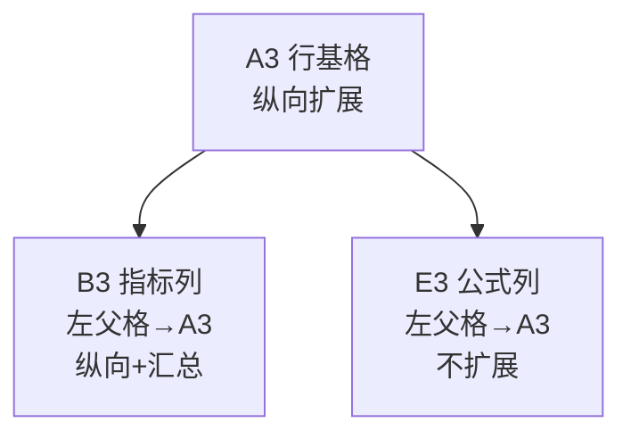
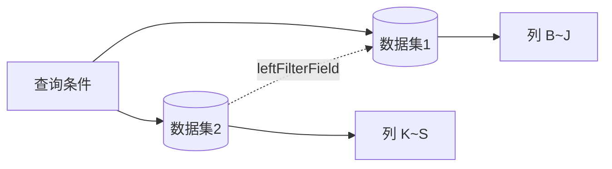

# 报表需求分析交付规范（仅用户要「分析」时必做）

> **冷启动禁止通读（纯搭表）**：见 `cold-start-scan-guide.md`。
> **适用范围**：凡用户**明确要求**「需求分析」「报表需求分析」「根据效果图/截图分析」「报表搭建指导 / 图示」时，按本规范输出完整分析 + **报表搭建图示**。
> **不适用**：用户只要「搭建 / 创建报表 / 生成报表」—— **跳过本模板**，直接走 `api-report-build-fast-path.md` + `report-delivery-contract.md` **模式 A**（交设计器地址即结束）。
> **HTML 手册**：非强制；仅用户点名要 HTML/指导文档时才 `build_guide_html.py`。
>
> **与能力一/二关系**：本规范是能力二（搭建配置指导）在「分析」意图下的输出格式；**禁止**在纯搭表任务中先强制跑本规范再落库。

---

## 一、交付清单（缺一不可）

每次报表需求分析必须包含以下 **8 个章节**（顺序固定）：

| # | 章节 | 必含要素 |
|---|------|----------|
| 1 | 报表定位 | 名称、业务目的、报表类型（LIST/GROUP/COUNT…）、行基格说明 |
| 2 | 查询条件 | 条件名、字段类型、默认值、关系运算符、绑定数据集 |
| 3 | 数据集与数据集过滤 | 物理表/逻辑源、datasetFilter（queryInfoSave）规则 |
| 4 | 页面与网格布局图示 | ASCII 或 Mermaid：R1 分组行、R2 列名、R3 配置基格 |
| 5 | 父格与扩展方向图示 | 行基格、左父格链、公式格「不扩展」 |
| 6 | **列级配置总表** | 见 §二（每列 8 项） |
| 7 | 公式列说明 | 公式、除零规则、显示格式（百分比等） |
| 8 | 待业务确认项 | 口径歧义、缺字段、同比/累计定义 |

**禁止**：只写业务口径文字、不给搭建图示；只给列名列表、不写父格/筛选/汇总。

---

## 二、列级配置总表（核心）

对 **每一个数据列/公式列**（含行基格 A 列），必须填下表一行：

| 列 | 列名 | 字段/公式 | **字段类型** | **数据集** | **父格** | **扩展方向** | **显示方式** | **汇总方式** | **父格筛选** | **自定义筛选** |
|:--:|---|---|:---:|:---:|---|:---:|:---:|:---:|---|---|
| A | 大区/专项 | 大区/专项 | Text/Select | 合同表 | **无（行基格）** | 纵向 | 列表/分组 | — | — | — |
| B | 当月新客户合同数 | 合同号 | Text | 合同表 | A3 | 纵向 | 汇总 | COUNT DISTINCT | — | 业绩年月=当月 AND 合同种类=新签 |
| E | 当月伙伴签占比 | `IF(B3=0,"--",D3/B3)` | Formula | — | A3 | **不扩展** | 百分比 | — | — | — |

**字段类型** 枚举（写清物理类型 + 平台 componentKey 如有）：

`Text` · `Number` · `Money` · `Date`/`yearmonth` · `Select` · `Employee` · `Department` · `EBuilder` · `Formula` · `Const`

**父格**：单数据集且无指定计算时填 **默认**（见 `datasource-selection-and-parent-filter-guide.md` §〇）；勿臆造自定义坐标链。


**显示方式**：`列表` · `分组` · `排列` · `汇总` · `隐藏`

**汇总方式**：`—` · `sum` · `count` · `distinctcount` · `avg` · `max` · `min`

**父格筛选**（leftFilterField / 左父格筛选）：跨数据集时**仅连续同源区域的入口列**必填，同区域其余列填 `-`（见 `datasource-selection-and-parent-filter-guide.md` §二）。格式示例：

`合同.销售经理 = EBU团队.责任人`（fieldKey 见 cross-dataset-filter-guide.md）

**数据集选用**：先核主表是否已有用户/部门等展示字段；有则**不要**为显示再挂人员表/部门表（`datasource-selection-and-parent-filter-guide.md` §一）。
**自定义筛选**（customFilterField / 单元格级）：列口径差异写在此，示例：

`业绩年月=当月` · `合同种类=新签合同` · `签约渠道=伙伴签` · `客户名称 非空`

---

## 三、数据集过滤（datasetFilter）专表

与「列级自定义筛选」区分：**datasetFilter** 作用于整个数据集实例（设计器左侧数据集 → 筛选条件 / queryInfoSave）。

| 数据集 | 逻辑关系 | 字段 | 运算符(func) | 值 | 说明 |
|---|---|---|:---:|---|---|
| 直销合同业绩表 | AND | 核算机构 | NotContain/uncontains | 亘岩 | 剔除专项机构 |
| 直销合同业绩表 | AND | 核算机构 | NotContain | 契约锁 | … |
| EBU团队 | AND | 负责人 | eq | `{userid}` | 行级权限（若需要） |

> API 写入见 `dataset-query-filter-guide.md`；**禁止**与 saveQueryItem（高级搜索）混用。

---

## 四、查询条件专表

| 显示名 | 绑定字段 | **字段类型** | 关系 | 默认值 | **显示方式**（必填） | 备注 |
|---|---|:---:|:---:|---|:---:|---|
| 年份 | 业绩年月.年 | Number/Select | Equals | `{thisyear}` | **高级搜索**（默认） | 驱动 R1 动态标题 |
| 月份 | 业绩年月.月 | Select | Equals | `{thismonth}` | **高级搜索**（默认） | 01–12 |

> **显示方式**：设计器必填；默认「高级搜索」（`showWhere: advancedSearch`）；用户指定「筛选」时写筛选（`filter`）。**不可留空**。见 `query-condition-api-guide.md` §2.1。
> 日期区间 21 项、asNameIndex 等见同文档。

---

## 五、搭建布局图示（必须输出 ≥4 张）

### 5.1 页面整体布局

```text
┌─────────────────────────────────────────────────────────────┐
│ {报表名称} │
├─────────────────────────────────────────────────────────────┤
│ [查询条件区] [搜索] [重置] [导出] [打印] [更多] │
├─────────────────────────────────────────────────────────────┤
│ 报表 Sheet 工作区 │
└─────────────────────────────────────────────────────────────┘
```

### 5.2 网格与表头合并（R1/R2/R3）

```text
 A B C …
R1 ┌─────────┬──────────────── 分组标题1 ────────────────┬──────── 分组标题2 ────────┐
R2 │ 列名A │ 列名B │ 列名C │ …
R3 │ ★行基格 │ 指标B │ 指标C │ … ← 数据区起点，行基格纵向扩展
 │ 维度值1 │ … │ … │
 │ 维度值2 │ … │ … │
```

- 标注 **★ 行基格** 坐标（如 A3）
- 标注 R1 合并范围与背景色（若效果图有分区色）
- R1 动态标题规则：`{查询年}-{查询月}` + 固定后缀

### 5.3 父格与扩展方向（Mermaid 或 ASCII）



### 5.4 数据集挂载关系



### 5.5 列级筛选叠加示意（可选，多口径报表建议画）

```text
 [datasetFilter 全局] + [列 customFilter 时间/新客/伙伴] + [父格筛选 跨表关联]
```

### 5.6 Sheet1 式单元格配置示例（R3 任选一列展示 6 项）

```text
┌──────────────────────────────────────────┐
│ D3 当前月份新客户伙伴签合同数量 │
├──────────────────────────────────────────┤
│ 字段： 合同业绩表.合同号 │
│ 父格： A3（大区/专项） │
│ 显示方式： 汇总 │
│ 扩展方向： 纵向扩展 │
│ 父格筛选： -（同数据集无） │
│ 自定义筛选：业绩年月=当月 AND 新客 AND 伙伴签 │
└──────────────────────────────────────────┘
```

---

## 六、三类筛选分工（必须在分析中写清）

| 类型 | 配置位置 | API | 典型用途 |
|---|---|---|---|
| **查询条件** | 报表顶部高级搜索 | saveQueryItem | 年月、大区、负责人 |
| **数据集过滤** | 左侧数据集筛选 | queryInfoSave | 核算机构剔除、行级权限 |
| **自定义筛选** | 单元格属性 | customFilterField | 新客/伙伴签/当月/年累计/去年同期 |
| **父格筛选** | 跨数据集单元格 | leftFilterField | 销售经理=责任人 |

**禁止重复**：已在 datasetFilter 的全局规则（如核算机构 NotContain ×7）**不要**再写入每个单元格 customFilter。

---

## 七、公式列规范（分析阶段即写明）

| 列 | 公式 | 除零 | 父格 | 扩展 |
|---|---|---|---|---|
| E | `IF(B3=0,"--",D3/B3)` | 显示 `--` | A3 | 不扩展 |

API 写入约束见 `formula-cell-api-guide.md`（cellText 无前导 `=`）。

---

## 八、完整示例索引

- **EBU 37 列分组表**：`本地工作目录` + `outputs/新版需求-EBU经营数据统计_字段映射.json`
- **新客户伙伴签约 19 列**：对话示例「2026-06 新客户伙伴签约统计报表」需求分析（A~S 列、双分组表头）

---

## 九、自检清单（交付前必过）

- [ ] 是否包含 **§一 全部 8 章节**？
- [ ] **列级配置总表**是否每列都有：字段类型、父格、扩展方向、汇总、父格筛选、自定义筛选？
- [ ] 是否单独给出 **数据集过滤表** 和 **查询条件表**？
- [ ] 是否至少有 **网格布局图 + 父格扩展图**？
- [ ] 行基格坐标是否明确（如 A3 / F3）？
- [ ] 公式列是否标注「不扩展」与除零规则？
- [ ] 三类筛选是否分工清晰、无重复？
- [ ] 是否列出 **待业务确认项**？
