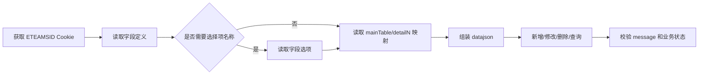

# eBuilder OpenAPI 调用方式说明

> 本文说明表单数据 OpenAPI 的内部调用准备、地址、认证方式和通用请求约定。新增、修改、删除、详情、分页、总数、字段、选项和表单标识映射的参数请参阅本目录对应文档。

---

## 调用前准备

1. 获取当前登录会话对应的 `ETEAMSID` Cookie，并确认 Cookie 尚未失效。
2. 确认调用账号对目标表单具有相应的数据权限。
3. 确认 `objId`，再按调用流程获取字段定义和明细表标识映射。

## 统一调用格式

| 项目 | 值 |
|---|---|
| **接口地址** | `/api/ebuilder/form/dataset/{path}` |
| **数据接口请求方式** | `POST` |
| **表单标识映射请求方式** | `GET` |
| **Content-Type** | `application/json`（GET 映射请求无请求体） |
| **认证方式** | `Cookie: ETEAMSID={{ETEAMSID}}` |

接口地址统一记录为相对路径 `/api/ebuilder/form/dataset/...`，调用时使用当前内部服务地址。所有接口只使用内部会话 Cookie，不在 URL Query 或 JSON 顶层传递其他认证参数。

## 请求头与请求模板

```http
Content-Type: application/json
Cookie: ETEAMSID={{ETEAMSID}}
```

数据接口统一使用以下请求体结构：

```http
POST /api/ebuilder/form/dataset/v2/{path}
Content-Type: application/json
Cookie: ETEAMSID={{ETEAMSID}}
```

```json
{
  "datajson": {}
}
```

表单标识映射接口使用同一 Cookie，请求体改为 Query 参数：

```http
GET /api/ebuilder/form/dataset/v1/getTableMapping?objId={{objId}}&reverse=false
Content-Type: application/json
Cookie: ETEAMSID={{ETEAMSID}}
```

## 标识与明细关系

| 标识 | 用途 |
|---|---|
| `objId` | 表单对象 ID，所有数据接口的表单上下文。 |
| `formId` | 表单设计器使用的业务表单 ID；本目录的数据接口不以它替代 `objId`。 |
| `id` | 字段接口返回的字段元数据 ID；获取选项时作为 `fieldName` Query 参数。 |
| `name` / `config.dataKey` | 字段名或组件数据键；按目标数据接口约定用于 `mainTable` 和明细行字段。 |
| `text` | 字段显示名称，只用于展示和人工确认。 |
| `compType` / `type` | 字段组件类型和逻辑类型；用于判断字段值格式以及是否需要读取选项。 |
| `subFormId` | 明细表 ID，通过映射接口与 `detail1`、`detail2` 等节点对应。 |

映射接口默认返回：

```json
{
  "mainTable": "{{mainTableId}}",
  "detail1": "{{subFormId1}}",
  "detail2": "{{subFormId2}}"
}
```

传 `reverse=true` 后返回反向关系（表标识为键、`mainTable` 或 `detailN` 为值）。这适合把响应中的 `subFormId` 还原为请求需要的明细节点。详细参数和异常响应见[映射接口文档](./ebuilder-openapi-formdata-gettablemapping.md)。

## 推荐调用流程



1. 获取并校验 `ETEAMSID` Cookie。
2. 确认 `objId`，调用字段接口获取 `compType`、`type`、`id`、`text`、`name`、`browserParams` 和明细归属等信息。
3. 如果业务逻辑需要选择框的选项名称，使用选择类字段的 `id` 调用选项接口，建立选项 ID 与名称的映射；不需要展示名称时跳过此步。
4. 调用映射接口确认 `detailN` 与 `subFormId` 的关系。
5. 先用详情或分页接口验证字段值结构，再执行写入接口。
6. 写入成功后保存返回的数据 ID；分页场景按 `pageNo`、`pageSize` 继续请求，总数接口使用完全相同的过滤条件。

## 通用响应与成功判断

数据操作接口通常返回：

```json
{
  "message": {
    "code": "0",
    "msg": "success"
  },
  "data": {
    "datajson": {
      "status": true
    }
  }
}
```

调用方应依次检查：

1. HTTP 请求是否成功；
2. `message.code` 是否为成功值，结合 `message.msg` 记录可对外展示的结果；
3. `data.datajson.status` 是否为 `true`；新增、修改、删除还应核对 `dataIds`，总数接口核对数值型 `datas`。

字段接口的业务字段位于 `data[].fields`；选项接口的业务字段位于 `data`；映射接口的业务字段直接位于 `data`。

## 安全与异常处理

- 真实 `ETEAMSID` 只能放在运行时配置中，不写入日志、示例和代码仓库。
- Cookie 失效或操作人无权限时，先重新登录获取有效 Cookie，并检查目标表单的数据权限。
- 查询和总数请求可以按业务需要重试；新增、修改、删除不要因网络超时直接盲目重试，先通过数据 ID 或详情接口确认结果。
- 分页接口的 `pageSize` 按接口约定设置，单次过大时拆分请求；删除接口执行前确认表单、条件和操作人。

## 接口索引

| 能力 | 请求路径 | 文档 |
|---|---|---|
| 新建表单数据 | `/api/ebuilder/form/dataset/v2/saveFormData` | [新建表单数据](./ebuilder-openapi-formdata-saveformdata.md) |
| 修改表单数据 | `/api/ebuilder/form/dataset/v2/updateFormData` | [修改表单数据](./ebuilder-openapi-formdata-updateformdata.md) |
| 删除表单数据 | `/api/ebuilder/form/dataset/v2/deleteData` | [删除表单数据](./ebuilder-openapi-formdata-deletedata.md) |
| 获取数据详情 | `/api/ebuilder/form/dataset/v2/getDataById` | [获取数据详情](./ebuilder-openapi-formdata-getdatabyid.md) |
| 获取分页数据 | `/api/ebuilder/form/dataset/v2/getAllData` | [获取分页数据](./ebuilder-openapi-formdata-getalldata.md) |
| 获取数据总数 | `/api/ebuilder/form/dataset/v2/getAllDataCount` | [获取数据总数](./ebuilder-openapi-formdata-getalldatacount.md) |
| 获取表单字段 | `/api/ebuilder/common/ds/fields` | [获取表单字段信息](./ebuilder-openapi-formdata-getfields.md) |
| 获取表单字段选项 | `/api/ebuilder/common/ds/options` | [获取表单字段选项](./ebuilder-openapi-formdata-getoptions.md) |
| 获取表单标识映射 | `/api/ebuilder/form/dataset/v1/getTableMapping` | [获取表单标识映射关系](./ebuilder-openapi-formdata-gettablemapping.md) |
