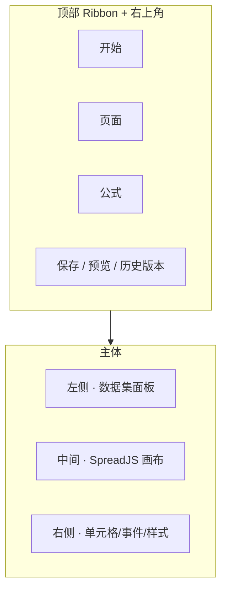

# 报表设计器 · 功能全景与 API 对照

> **页面**：`https://{host}/sp/edc/report/designer/{reportId}`  
> **示例**：`https://weapp.yunteams.cn/sp/edc/report/designer/1310535032076214273`  
> **源码**：`EdcReportDevDesignController.java`、`EdcReportDevBaseController.java`（weaver-edcreportd）  
> **UI 说明**：`report-help-guide.md`、`report-building-guide.md`  
> **鉴权**：`api-auth-headers.md`（Cookie.raw + eteamsid + User-Agent）

---

## 一、设计器进入时加载链

> **Live 实测**（2026-09-04 · 报表 `1310535032076214273` · 浏览器自动化抓包 + e10-login）见 §十一。

| 顺序 | 接口 | 说明 |
|------|------|------|
| 1 | `GET /api/bs/edc/report/baseInfo?id={reportId}&useTag=backend` | 报表名称/分组/应用 |
| 2 | `GET /api/edc/report/isPrivateDeploy` | 是否私有化部署 |
| 3 | `GET /api/bs/edc/dataset/list?hasField=true&reportId={reportId}` | 左侧数据集列表 |
| 4 | `GET /api/bs/edc/report/getReportDevInfo?reportId={reportId}` | workbook + fields + 数据集 |
| 5 | `GET /api/bs/edc/dataset/fieldsBySource?sourceId=&sourceType=logic` | 各数据源字段（按 source 多次） |
| 6 | `POST /api/bs/edc/report/getQueryItemNew` | 高级搜索条件（multipart: reportId + query） |
| 7 | `GET /api/bs/edc/dataset/fieldsAndOriginFields?datasetId=` | 各数据集字段详情（多次） |
| 8 | `GET /api/bs/edc/report/allPageSetting?sheetId={reportId}` | 分页/打印配置 |
| 9 | `GET /api/bs/edc/report/appReportRight?appId=&reportId=` | 当前用户编辑/删除权限 |
| 10 | `POST /api/bs/edc/report/permission/table/list/new` | 使用范围（查看权限列表） |

保存主链路：`POST saveReportDevInfo`（布局）+ 可选 `POST saveReportWithCacheConfig`（跨表筛选缓存）；保存时还会 `POST allPageSetting`（分页配置随保存提交）。

---

## 二、整体布局（三区 + 顶栏）



| 区域 | 作用 | 核心配置落点 |
|------|------|--------------|
| **左侧** | 数据集增删、字段拖拽、数据集级筛选/聚合/排序 | `addDataset` / `delDataset` / `queryInfoSave` |
| **中间** | 单元格布局、公式、合并、条件格式 | `workbook`（gzip+base64） |
| **右侧** | 单格属性：类型/父格/扩展/筛选/转换 | `fields[]` + workbook `style.cellType` |
| **顶部开始** | Excel 式编辑 + 保存/预览/条件格式 | 见 §三 |
| **顶部页面** | 查询/打印/分栏/布局/快照 | 见 §四 |
| **顶部公式** | 函数库 + 公式编辑 | 见 §五 |

---

## 三、Tab「开始」功能清单

> SpreadJS 原生能力（剪切/复制/粘贴/撤销/合并单元格等）写入 `workbook`，随 `saveReportDevInfo` 持久化。

### 3.1 文件与运行

| 功能 | UI 位置 | API / 行为 | 详细文档 |
|------|---------|------------|----------|
| **保存** | 右上角 | `POST /api/bs/edc/report/saveReportDevInfo` + `POST allPageSetting` | `formula-cell-api-guide.md` |
| **存为新版本** | 保存旁下拉 | `POST /api/bs/edc/report/saveAsVersion` | 本文 §七 |
| **预览** | 右上角 | `GET checkSave?sheetId=` 后跳转 `/sp/edc/report/view/{reportId}` | Live §11.2 |
| **历史版本** | 开始区 | `POST getVersionWithPage` · `GET rollbackReport` | 本文 §七 |
| **数据分析** | 开始区 | 侧栏分析图表配置（workbook 扩展） | `report-help-guide.md` §十一 |
| **代码块** | 开始区 | 自定义 JS/HTML 块（高级） | — |

### 3.2 字体与对齐（SpreadJS 工具栏）

| 功能 | 说明 |
|------|------|
| 字体 / 字号 / 加粗 / 斜体 / 下划线 | 单元格 `style.font` |
| 字体颜色 / 填充色 | `style.foreColor` / `style.backColor` |
| 对齐（左/中/右/上/下） | `style.hAlign` / `style.vAlign` |
| 自动换行 | `style.wordWrap` |
| 边框 | workbook border 配置 |

### 3.3 数字格式

| 功能 | 说明 | 注意 |
|------|------|------|
| 常规 / 数值 / 货币 / 会计 / 日期 / 时间 / 百分比 / 文本 | `style.formatter` **+** `formatterType`/`tag.formatterType`（成对；见 `cell-config-echo-guide.md`） | 货币须目录全等 + `huobi`，否则工具栏回显「常规」 |

### 3.4 条件格式

| 功能 | UI | workbook 字段 |
|------|-----|---------------|
| **突出显示** | 开始 → 条件格式 | `conditionFormats` 规则组 |
| **数据条** | 同上 | `lineDatas`（conditionRule） |
| **图标集** | 同上 | `iconDatas`（conditionRule；非 iconSets） |
| **清除规则** | 同上 | 清除所选/整表 |

详见 `report-help-guide.md` §七、`report-data-model.md` §六。

### 3.5 查询条件快捷入口

| 功能 | UI | API |
|------|-----|-----|
| 查询条件设置 | 开始区（或与「页面」重复入口） | `GET/POST saveQueryConfig`、`updateQueryType` |
| + 添加查询条件 | 同上 | `POST saveQueryItem` |

> **勿与数据集筛选混淆**：高级搜索 = `saveQueryItem`；左侧数据集筛选 = `queryInfoSave`。见 `query-condition-api-guide.md` / `dataset-query-filter-guide.md`。

---

## 四、Tab「页面」功能清单

### 4.1 查询

| 功能 | UI 路径 | API | 说明 |
|------|---------|-----|------|
| **查询设置** | 页面 → 查询设置 | `GET getQueryConfig?sheetId={reportId}` | Live 实测：打开面板即 GET |
| **更新查询类型** | 查询设置内 | `POST updateQueryType` | `queryType`: **`["advance"]` / `["filter"]`（JSON 数组）** ⚠️ 会批量覆盖所有条件的 `queryType` |
| **+ 添加查询条件** | 页面 → + 添加 | `POST saveQueryItem` | 条件字段 JSON 数组 |
| **删除条件** | 条件列表 | `POST delQueryItem` | 按 id |
| **条件排序** | 拖拽排序 | `POST sortQueryItem` | sortList |
| **联动条件** | 条件下拉联动 | `GET queryRelatedItem` | 可读联动候选 |

**saveQueryConfig 示例**：`{"advancedSearchType":"openCondition"}`（`queryType` 若传须用数组短码 `'["advance"]'`，见 `query-condition-api-guide.md` §2.1.3）

### 4.2 单元格

| 功能 | UI 路径 | 落点 |
|------|---------|------|
| **冻结单元格** | 页面 → 单元格 → 冻结 | 见下表；**禁止只写 `frozenRowCount`** |
| **取消冻结** | 同上 | 删 `fixed-cell-tag`、清 `fixed`/`fixedCell`、冻结计数归零 |

#### 4.2.1 冻结单元格 — 锚点落点（强制）

> 完整解析见 **`layout-showlocation-freeze-guide.md`**。

| 落点 | 说明 |
|------|------|
| Const `cellText=fixed-cell-tag` | 锚点坐标 `(x,y)`；冻结其**上方+左侧**（不含本格） |
| `cell.tag.fixed=true` → `field.fixed=1` | Custom/SimpleList 预览靠此算 `frozenRowCount=x`、`frozenColumnCount=y` |
| `sheet.tag.fixedCell={x,y}` | 设计器记住锚点 |
| `frozenRowCount` / `frozenColCount` | 设计区辅助线；**不能替代**上面三项 |

「冻结表头」默认锚点 = `(表头行+1, 0)`。

### 4.3 样式

| 功能 | UI 路径 | 落点 |
|------|---------|------|
| **主题模板** | 页面 → 样式 → 主题模板 | workbook 主题 id（10 套预置） |
| **配色交替方式** | 页面 → 样式 → 配色交替 | 斑马纹行/列色 |
| **背景色 / 文本样式** | 页面 → 样式 | 单元格或 sheet 级 style |

### 4.4 打印与分页

| 功能 | UI 路径 | API |
|------|---------|-----|
| **分页设置** | 页面 → 打印与分页 | `POST/GET pageSetting`、`allPageSetting` |
| **打印区域 / 重复表头 / 页边距** | 同上弹窗 | `pageSetting` JSON（PageSetting 实体） |
| **动态 Sheet 页** | 分页高级 | 按字段值拆分 Sheet |

**pageSetting 参数**：`sheetId`、`sheetIndex`、`pageSetting`（JSON 串）、`enable`

### 4.5 报表展示

| 功能 | UI 路径 | API / 落点 |
|------|---------|------------|
| **列排序筛选** | 页面 → 报表展示 | `saveSystemOption` |
| **子格合并** | 同上 | sheetConfig / 单元格属性 |
| **解析优化 · 行式加载** | 同上 | `sheetConfig.simpleList=true`（单数据集列表） |
| **解析优化 · 数据预聚合** | 同上 | `sheetConfig.dataPreAgg=true`（默认开） |
| **报表分栏** | 同上 | 分栏模式/栏数/复制标题（见 knowledge-base §4.7） |
| **按钮控制** | 同上 | 隐藏导出/打印/快照等预览按钮 |
| **启用编辑 / 工具栏** | 同上 | 预览页可编辑、Spread 工具栏 |
| **启用洞察** | 同上 | `POST saveEnableInsight` |

### 4.6 页面布局

| 功能 | UI 路径 | 落点 |
|------|---------|------|
| 显示网格线 | 页面 → 页面布局 | sheetProps.gridLine |
| 行号 / 列头 | 同上 | rowHeaderVisible / colHeaderVisible |
| 无限滚动条 | 同上 | scrollPage |
| **数据展开 · 树形默认展开** | 同上 | sheetConfig 树形展开 |
| **报表显示位置** | 同上 | **`showLocation`：居左=`1`，居中=`2`**（**禁止写 `0` 当居左**，见 §4.6.2） |

#### 4.6.1 网格线 / 行号 / 列头 — 默认关闭（强制 · 防 500）

> **平台常规默认关闭**。Agent **不得**在用户未明确要求时自行开启。  
> **实测固化**：`saveReportDevInfo` 曾 500「报表内部错误」，二分定位为 workbook sheet **多写了 `gridline` 字段（存在即 500）**，去掉即恢复。  
> 落库前须 `edc-report validate gridline`（`validate blank` / `safe_report_save` 已联动剔除）。

| 能力 | 关闭（默认 · 必须保持） | 开启（仅当会话明确要求） |
|------|------------------------|--------------------------|
| 显示网格线 | sheetProps/`pageSetting.gridLine: 0` | `1`（仅 page 层） |
| 行号 | `rowHeaderVisible: 0` / pageSetting `rowHeader: 0` | `1` |
| 列头 | `colHeaderVisible: 0` / pageSetting `colHeader: 0` | `1` |

**合法 vs 禁止**

| 位置 | 字段 | 规则 |
|------|------|------|
| sheetProps / pageSetting | `gridLine` | **仅此合法**：int `0\|1`，默认 `0` |
| workbook `sheets.*` | `gridline` / `gridLine` / `__gridline` | **一律禁止写入**（存在 → 500「报表内部错误」） |

**强制规则**

1. 新建 / API 建表 / 改 layout：网格线**默认关**；page 层写 `gridLine: 0`（或不写）。
2. **禁止**在 gzip 提交的 workbook JSON 任意 sheet 上出现 `gridline`（不论对象还是标量）。
3. **禁止**「为好看 / 对齐 SpreadJS 文档」往 workbook 补 `gridline` 对象。
4. 局部保存：`mergeWorkbookSafe` / `stripWorkbookGridlineKeys` 落库前自动删掉禁止键。
5. 用户明确要求「打开网格线」时：只改 **sheetProps / allPageSetting** 的 `gridLine=1`，**仍不**往 workbook 写 `gridline`。
6. CLI：`edc-report validate gridline`；`--fix` 输出已剔除禁止键的 sheets；`--strict` 将未点名却 `gridLine=1` 升为 error。

**反例（必 500）**：`sheets.Sheet1.gridline = { showHorizontalGridline: false, ... }` 或任意 `gridline` 键。  
**正例**：workbook 不写网格线字段；`sheetProps`/`pageSetting` 用 `{ gridLine: 0 }`。

#### 4.6.2 报表显示位置 showLocation（强制）

> 完整解析见 **`layout-showlocation-freeze-guide.md`**。

| UI | `tag.showLocation` / `sheetProps.showLocation` |
|----|--------------------------------------------------|
| 居左 | **`1`** |
| 居中 | **`2`** |

**禁止** `showLocation: 0`：前端 `tag.showLocation ? … : 2` 会把 `0` 当成缺省 → 显示仍居中。

### 4.7 快照设置

| 功能 | UI 路径 | API / 脚本 | 说明 |
|------|---------|--------------|------|
| 快照生成策略 | 页面 → 快照设置 | `saveReportDevInfo` + `workbook.snapshot` | cron 透传 escheduler；`functionName=createSnapshot` |
| 定时快照脚本 | — | `scripts/set_snapshot_schedule.js` / `edc-report snapshot set` | **必须**经 `safe_report_save.js`；默认名 **`{报表名}-{date}-{time}`**；`sheetId=String(reportId)` 禁 Number |
| 空白门禁 | — | `validate_designer_blank_guard.js` / `verify blank` | 见 `designer-blank-prevention-guide.md` |
| 查看快照列表 | 运行态 | `POST getSnapshotDatas` | |
| 还原版本（layout 事故） | 版本管理 | `GET rollbackReport` | 优先于空 workbook 重保存 |

> **设计区保护**：快照是唯一常走 `saveReportDevInfo` 的「局部功能」。禁止提交空 `workbookProps`；禁止 `Number(雪花 ID)`；保存前后校验 `fields.length`。

### 4.8 其他页面级能力

| 功能 | UI 路径 | 说明 |
|------|---------|------|
| **二维报表组件** | 页面 → 二维报表组件 | 嵌入二维分析组件 |
| **填报** | 单元格类型=控件字段 | 明细表、只读/必填，见 `report-help-guide.md` §十 |
| **使用范围** | 报表属性（部分版本在基础信息） | 查看权限，见 `report-lifecycle-api-guide.md` savePermissions |

---

## 五、Tab「公式」功能清单

### 5.1 插入函数

| 分类 | 常用函数 | 设计器行为 |
|------|----------|------------|
| **数学和三角** | SUM, AVERAGE, COUNT, MAX, MIN, ROUND, ABS | 公式 Tab → 插入函数 → 选类 → 选函数 |
| **逻辑** | IF, IFERROR, AND, OR, NOT | 合计行/占比/除零保护必用 IFERROR |
| **文本** | LEFT, RIGHT, MID, LEN, CONCAT | — |
| **日期和时间** | YEAR, MONTH, DAY, DATE, DAYS, DATEDIF | DAYS 结束日期在前 |
| **信息** | ISERROR, ISBLANK, ISNUMBER | — |
| **组合公式** | 多函数嵌套 | 平台占比/同环比为前端公式，非 Java 计算 |

### 5.2 使用方式

1. 选中单元格 → 公式 Tab → **插入函数** → 向导填参  
2. 或在单元格直接输入 `=SUM(` 联想  
3. 单元格类型须为 **公式字段**（`FormulaCellType`）

### 5.3 API 写入公式（脚本/Skill 必守）

| 规则 | 说明 |
|------|------|
| `cellText` / `formula` **无前导 `=`** | 设计器输入 `=IF(...)` → 存储 `IF(...)` |
| `countType=count` | 公式格 displayType 用 Group，禁止 List/none |
| 自定义父格 | 按分组算公式时，公式格也需设左/上父格 |
| 双保存 | `saveReportDevInfo` + `saveReportWithCacheConfig`（有跨表筛选时） |

详见 **`formula-cell-api-guide.md`**（强制加载）。

### 5.4 公式校验

| 接口 | 用途 |
|------|------|
| `POST /api/bs/edc/report/preCheck` | 保存前 workbook 预检 |
| `GET /api/{module}/ds/checkFunction` | 数据集侧公式校验 |

---

## 六、左侧数据集面板

> **侧栏 `…` 菜单完整 API** → **`dataset-sidebar-ops-guide.md`** · CLI `edc-report dataset …`

| 操作 | UI | API |
|------|-----|-----|
| 添加数据集 | 「+」 | `POST addDataset`（`sourceType=LOGIC` + `sourceGroup=weaver-ebuilder-form-service`）；见 `add-dataset-registration-guide.md` |
| **自定义名称** | `…` → 自定义名称 | `GET /api/bs/edc/dataset/rename?datasetId&name&nameLabelId` |
| **数据聚合** | `…` → 数据聚合 | `POST/GET …/dataset/aggregationSave\|Get`（`aggreData`）；**≠** `sheetConfig.dataPreAgg` |
| **数据排序** | `…` → 数据排序 | `POST/GET …/dataset/sortSave\|Get`（`sortData`） |
| **替换数据集** | `…` → 替换数据集 | `POST /api/bs/edc/dataset/replaceDataset`（JSON + `fieldMap`）→ 新 datasetId |
| **移除** | `…` → 移除 | 先 `GET checkDataSetUsed`；`POST /api/bs/edc/report/delDataset`（`sourceIds`=**datasetId**） |
| 筛选条件 | `…` → 筛选 | `POST/GET queryInfoSave\|Get`；见 `dataset-query-filter-guide.md` |
| 数据预览 | `…` → 数据预览 | `GET /api/bs/edc/dataset/getPreviewData?dataSetId=` |

字段拖拽到画布 → 生成 **数据字段** 单元格；配置写入 `fields[]` 五元组（`name` + `nameIndex` + `dataSetId` + `text` + `fieldKey`）。

---

## 七、右侧属性面板

### 7.1 「单元格」Tab

| 属性 | 枚举/说明 | 跨文档 |
|------|-----------|--------|
| 单元格类型 | 文本/数据/公式/序号/全选/数据更新时间/控件 | `report-knowledge-base.md` §2 |
| 数据集合 / 字段 | 绑定数据集字段 | — |
| 左父格 / 上父格 | 默认 / 无 / 自定义坐标 | 父格拓扑见 `parent_cell_planner.py` |
| 扩展方向 | 纵向 / 横向 / 不扩展 | — |
| 显示方式 | 分组 / 排列 / 汇总 / 树形 | 汇总含求和/计数/平均等 |
| 日期分组 | 年 / 年月 / 不设置 | — |
| 分组排序 | 升序 / 降序 / 不排序 | — |
| **筛选** | 父格筛选 / 自定义筛选 / 结果筛选 | `cross-dataset-filter-guide.md` |
| **字段转换** | 人员/部门/部门全路径/checkbox/选择框/颜色/分值图标/斜线/关联/图片 | **`cell-transform-guide.md`** · `transType`+`browserType` |
| **HTML转换** | 是/否 | `isHtml` `"1"|"0"` |
| **前缀/后缀** | 文本 | `prefixAndSuffix:["前","后"]` |
| **条码** | 无/条码/二维码 | `qrcodeType` · `qrcodelink` |
| **隐藏内容** | 是/否 | `hiddenContext` `"1"|"0"`（≠ 显示方式） |
| **文字方向** | 左→右 / 右→左 / 竖排 / 旋转 | `textDirection` 枚举 |

### 7.2 「事件」Tab

> **完整**：`event-hreflink-guide.md` · CLI `validate href`

| 属性 | 落库 | 说明 |
|------|------|------|
| PC链接地址 | `pcHreflink` | 可含 `{A1}` / `{searchfield001}` / `$ds.field$` |
| H5链接地址 | `h5Hreflink` | 移动端覆盖 PC |
| 打开方式 | `openType` | 弹出页=`blank` · 当前页=`self` · 执行js=`jsscript` |
| 传单元格值 | 链接占位 | 当前格 / 父格 / 父格的父格（手册 §5.3） |
| 传查询条件值 | `{searchfield00x}` | 与 asNameIndex 对齐 |

### 7.3 「样式」Tab

| 属性 | 说明 |
|------|------|
| 主题模板 / 配色交替 | 与「页面→样式」联动 |
| 背景色 / 文本样式 | 单元格级覆盖 |

---

## 八、版本与缓存 API

| 功能 | 方法 | 路径 |
|------|------|------|
| 版本列表 | POST | `/api/bs/edc/report/getVersionWithPage` |
| 存为新版本 | POST | `/api/bs/edc/report/saveAsVersion` |
| 还原版本 | GET | `/api/bs/edc/report/rollbackReport?sheetId=&originSheetId=` |
| 布局缓存 | POST | `/api/bs/edc/report/cacheReportDevInfo` |
| 分页缓存 | POST | `/api/bs/edc/report/cachePageSetting` |
| 配置缓存 | POST | `/api/bs/edc/report/cacheReportConfig` |
| 带缓存保存 | POST | `/api/bs/edc/report/saveReportWithCacheConfig` |
| 保存前检查 | GET | `/api/bs/edc/report/checkSave?sheetId=&query=` |

### 8.1 存为新版本（saveAsVersion）

**UI**：设计器「开始」→ 保存旁下拉 → **存为新版本**（与「保存」不同：会 copySheet + 写入版本表，原报表 ID 不变）。

**请求**（`application/x-www-form-urlencoded`）：

| 参数 | 说明 |
|------|------|
| `sheetId` | 当前报表 ID |
| `versionName` | 版本名称（展示在历史版本列表） |

**版本号** `reportVersion`：服务端自动递增 `V1`、`V2`…（与 `versionName` 无关）。

**versionName 默认命名（与设计器一致）**：

```
{当前报表名称}-{YYYY-MM-DD}-{HH-mm-ss}
```

示例：`供应商采购进货明细表-2026-09-04-14-09-30`

脚本：`.workbuddy/designer-capture/save_as_version.js`（禁止自造 `V20260904…` 这类 UTC 压缩名）。

**版本列表**（POST form）：

```
pageNo=1&pageSize=10&dateRange=["",""]&sheetId=<reportId>&versionName=&creators=[]
```

**注意**：每次调用 `saveAsVersion` 都会新增一条版本；查列表请用 `--list-only`，勿重复 POST。

---

## 九、功能 → API 速查总表

| 用户说法 | 优先 API | Skill 文档 |
|----------|----------|------------|
| 保存报表 / 改布局 | saveReportDevInfo | formula-cell-api-guide |
| 加数据集 | addDataset | datasource-metadata-guide |
| 数据集筛选 / 行级权限 | queryInfoSave | dataset-query-filter-guide |
| 高级搜索 / 查询条件 | saveQueryItem + saveQueryConfig | query-condition-api-guide |
| 父格筛选 / 跨表 | workbook fields + saveReportWithCacheConfig | cross-dataset-filter-guide |
| 公式 / 合计 / 占比 | workbook Formula 格 | formula-cell-api-guide |
| 分页 / 打印 | pageSetting | 本文 §4.4 |
| 存版本 / 还原 | saveAsVersion / rollbackReport | 本文 §八 |
| 报表权限 / 使用范围 | savePermissions | report-lifecycle-api-guide |
| 列表页删除/回收站 | deleteReport / revertRecycleReport | report-lifecycle-api-guide |

---

## 十、Skill 加载规则

| 触发场景 | 必读文档 |
|----------|----------|
| 打开设计器 / 解释菜单 / 截图识别 UI | **本文** + `report-building-guide.md` §二 |
| 写 workbook / 保存布局 | `formula-cell-api-guide.md` |
| 配查询条件 | `query-condition-api-guide.md` |
| 配数据集筛选 | `dataset-query-filter-guide.md` |
| 配跨表父格筛选 | `cross-dataset-filter-guide.md` |
| 概念/报表类型/父格规则 | `report-knowledge-base.md` |
| 列表页/权限/回收站 | `report-lifecycle-api-guide.md` |

**三种筛选禁止混用**：高级搜索（saveQueryItem）≠ 数据集筛选（queryInfoSave）≠ 单元格 customFilterField。

---

## 十一、yunteams Live 抓包（2026-09-04）

| 项 | 值 |
|----|-----|
| 设计器 URL | `https://weapp.yunteams.cn/sp/edc/report/designer/1310535032076214273` |
| 报表 | 销售经营分析报表 |
| appId | `1310076187728674816` |
| 抓包脚本 | `.workbuddy/designer-capture/capture_designer_ribbon_live.js` |
| 原始 JSON | `.workbuddy/designer-capture/output/designer_ribbon_capture_1310535032076214273.json` |

### 11.1 进入设计器（页面 load，12 条 report/dataset API）

见 §一表格（顺序与 query 参数以 live JSON 为准）。

**`getQueryItemNew` 请求体（multipart）**

| 字段 | 示例值 |
|------|--------|
| `reportId` | `1310535032076214273` |
| `query` | `{}` |

**`permission/table/list/new` 请求体（JSON）**

```json
{
  "permissionId": "report_view",
  "permissionType": 16,
  "id": "1310535032076214273",
  "sourceId": "1310535032076214273",
  "pageSize": 10000,
  "current": 1
}
```

### 11.2 Ribbon 按钮 → 触发 API（Live）

| Tab | 按钮 | 触发 API | 备注 |
|-----|------|----------|------|
| **开始** | **保存** | `POST saveReportDevInfo` + `POST allPageSetting` | 保存布局时分页配置一并提交 |
| **开始** | **预览** | `GET checkSave?sheetId={reportId}&query=` | 预览前检查未保存变更 |
| **开始** | **查询设置** | `GET getQueryConfig?sheetId={reportId}` | 打开查询设置面板 |
| **开始/页面** | 添加查询条件 | （无新 API） | 仅 UI 面板；写入走 `saveQueryItem` |
| **开始** | 条件格式 | （无 API） | 纯 workbook 本地编辑 |
| **页面** | 主题模板 | （无 API） | 主题写入 workbook，随保存持久化 |
| **公式** | 插入函数 / 函数分类 | （无 API） | SpreadJS 本地公式编辑 |

**未触发 HTTP 的能力**（Live 点击后 0 新 API）：SpreadJS 字体/对齐/边框、冻结单元格、子格合并、行式加载、公式插入等 — 均写入 `workbook`，经 **保存** 一次性 `saveReportDevInfo` 落库。

**二级菜单**（页面 → 单元格/打印与分页/报表展示…）：Ribbon 分组在窄屏下折叠为 `.text-item`，需 hover 展开；自动化脚本对部分项报 `not visible`，但行为与帮助文档一致（本地配置 + 保存）。

### 11.3 保存时 `allPageSetting` 表单字段（Live）

| 字段 | 说明 |
|------|------|
| `sheetId` | 报表 ID |
| `designKey` | 设计器会话 UUID |
| `pageSetting` | JSON 数组，含 `split`（分页/分栏）、`scrollPage` 等 |

### 11.4 复现抓包

```bash
cd .workbuddy/designer-capture
npm install
node capture_designer_ribbon_live.js
# 可选环境变量：REPORT_ID / APP_ID
```

鉴权：自动读 `e10-login status` 的 ETEAMSID；失效时脚本尝试 passport 表单登录。
