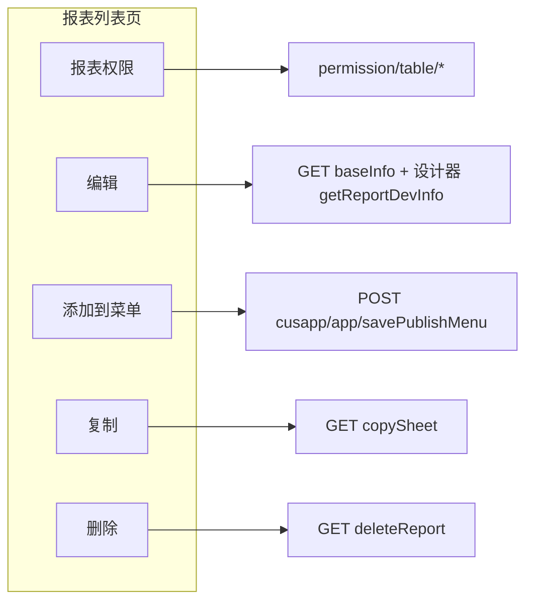
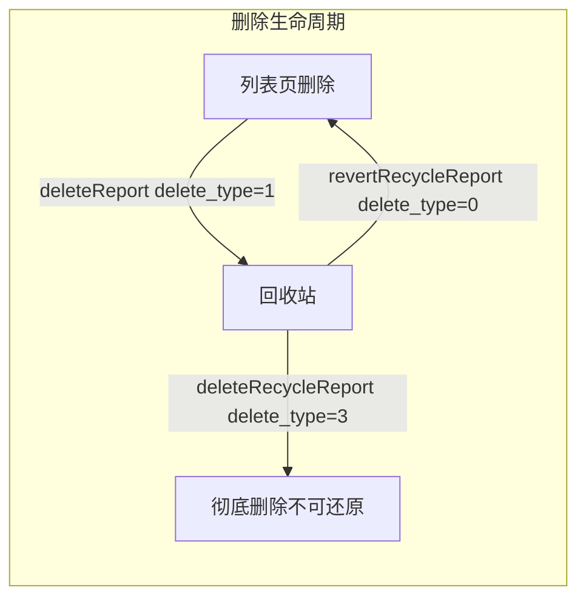

# 报表列表页 · 生命周期管理 API 指南

> **页面场景**：`/sp/ebdapp/detail/{appId}/report` 报表卡片「…」菜单  
> **源码依据**：`EdcReportDevBaseController.java`、`EdcDataPermissionController.java`、`EdcReportDevDesignController.java`（weaver-edcreportd）  
> **菜单 HTTP 封装**：e10-cli `menu.js` → `POST /api/cusapp/app/savePublishMenu`  
> **鉴权**：必须走 e10-login，请求头见 `api-auth-headers.md`（Cookie.raw + eteamsid + User-Agent 三项）

---

## 一、页面加载（进入报表列表）

| 接口 | 方法 | 说明 |
|------|------|------|
| `/api/bs/edc/report/group/list?appid={appId}` | GET | 报表分组树 |
| `/api/bs/edc/report/appRight?appId={appId}` | GET | 当前用户在应用下的报表操作权限（增删改） |
| `/api/bs/edc/report/list?appid={appId}&groupid=-1&objId=-1` | GET | 报表卡片列表（含 deletePermission 等） |
| `/api/bs/edc/report/getReportModels` | GET | **模版创建**：系统模板列表（见 `report-create-modes-guide.md`） |

**单张报表操作前（可选校验）**

| 接口 | 方法 | 说明 |
|------|------|------|
| `/api/bs/edc/report/appReportRight?appId={appId}&reportId={reportId}` | GET | 单报表 EDIT/DELETE/ADD 权限 |

---

## 一附、新建报表对话框 · 三种模式（强制）

> 页面「新建报表」三卡片 → 同一 `POST /api/bs/edc/report/baseInfo`，靠 **`reportModel` / `quicklyParam`** 分支。  
> **完整载荷与 QuicklyParam 结构** → **`report-create-modes-guide.md`**。  
> CLI：`edc-report create blank|template|quick` · `edc-report create models`

| UI 卡片 | 关键字段 | 说明 |
|---------|----------|------|
| 从空白创建 | `reportModel=0`，无 `quicklyParam` | 空壳；再 `addDataset` + `saveReportDevInfo` |
| **模版创建** | **`reportModel={模板ID}`** | 先 `GET getReportModels`；服务端 `copySheet` |
| **快速构建-列表式** | **`quicklyParam` JSON 串**（`reportModel=0`） | 服务端挂数据集 + 生成列表字段；默认 `simpleList` |

服务端优先级：`reportModel>0` → 模版；否则 `quicklyParam` 非空 → 快速构建；否则空白。

**勿混淆** Skill `assets/template-*-report.json`（Agent 脚手架）与平台 `getReportModels` 模板。

---

## 一附 B、列表页其它操作（分组 / 视图 / 移动 / 转移 / 矩阵）

> **完整规则与 CLI** → **`report-list-page-ops-guide.md`** · `edc-report policy list-page`

| UI | API / 机制 | CLI |
|----|------------|-----|
| 新建/删除分组 | `group/list` + `group/save`（删=从 JSON 去掉） | `edc-report group list\|add\|delete` |
| 卡片/列表视图 + 快速排序 | **localStorage / 内存**，无服务端写 | 仅文档；可读 `tableView` |
| 权限矩阵增删 | `matrix/list` + `savePermissions` / `matrix/save` | `edc-report scope matrix …` |
| 移动到 | `POST removeReport`（改 group_id）；**无自建分组则不可选** | `edc-report lifecycle move` |
| 转移到 | `app/list` 选启用应用 + `transferReport`；**重名须确认** | `edc-report app search` · `lifecycle transfer` |

---

## 二、菜单项 → API 对照（核心）



### 1. 报表权限设置

> **完整对象类型 / 禁用范围 / 矩阵配置** → 必加载 **`report-permission-guide.md`**（九种通用对象 + 矩阵 + 运行时判定）。

**弹窗 UI 结构**

| 顶层 Tab | 子 Tab | 写入字段 / 接口 |
|----------|--------|-----------------|
| **使用范围** | 通用 | `savePermissions.viewRight`（`permissionType: 1`） |
| **使用范围** | 矩阵相关 | `savePermissions.viewMatrixRight` 或 `matrix/save`（`rightsType: "1"`） |
| **禁用范围** | 通用 | `savePermissions.disableRight`（`permissionType: -1`） |
| **禁用范围** | 矩阵相关 | `matrix/save`（`rightsType: "-1"`；**不在** savePermissions 内） |

**打开弹窗（读）**

| 步骤 | 接口 | 方法 | Body / Query |
|------|------|------|----------------|
| 列表（使用/禁用通用） | `/api/bs/edc/report/permission/table/list/new` | POST | `permissionType`: **`1`**=使用范围，**`-1`**=禁用范围；含 `permissionId`、`id`=reportId、`params.appId` |
| 矩阵（使用/禁用） | `/api/bs/edc/report/permission/matrix/list` | POST | `type`: **`"1"`**=使用矩阵，**`"-1"`**=禁用矩阵 |
| 详情 | `/api/bs/edc/report/permission/table/info` | POST | `permissionId` + `id` |
| 兼容读 | `/api/bs/edc/report/permission?id={reportId}` | GET | 旧接口，当前实现常返回空 map；**以 table/list/new 为准** |

**保存（写）**

| 接口 | 方法 | Content-Type | Body |
|------|------|--------------|------|
| `/api/bs/edc/report/permission/table/savePermissions` | POST | `application/json` | 见下方 JSON 结构 |
| `/api/bs/edc/report/permission` | POST | `multipart/form-data` | `id` + `permission`（JSON 字符串，含 viewRight/disableRight） |
| `/api/bs/edc/report/permission/matrix/save` | POST | `application/json` | 矩阵权限行列表 |

**savePermissions 请求体结构**（`EdcDataPermissionController.savePermissions`）：

```json
{
  "<reportId>": {
    "viewRight": [
      {
        "sourceId": "<reportId>",
        "permissionId": "<DataRightType.REPORT_VIEW>",
        "targetType": 1,
        "targetId": "<userOrDeptId>",
        "permissionType": 1,
        "objType": "resource",
        "seclevel": { "min": -999, "max": 999 }
      }
    ],
    "viewMatrixRight": [],
    "disableRight": []
  }
}
```

> 权限对象字段与前端 **shareBrowser** 一致。九种通用类型（人员 `resource`、部门、分部、角色、群组、岗位、所有人、外部联系人、所有外部人）及 targetType 对照见 **`report-permission-guide.md` §三**。

---

### 2. 编辑报表

编辑 = **打开设计器** + **读写布局**，不是单一接口。

| 阶段 | 接口 | 方法 | 说明 |
|------|------|------|------|
| 读基础信息 | `/api/bs/edc/report/baseInfo?id={reportId}&version=1.0.0&useTag=backend` | GET | 编辑前加载名称/分组等 |
| 读布局 | `/api/bs/edc/report/getReportDevInfo?reportId={reportId}` | GET | 设计器 workbook |
| 写布局 | `/api/bs/edc/report/saveReportDevInfo` | POST | multipart：`reportId`、`workbook`(gzip+base64)、`designKey` 等 |
| 写基础信息 | `/api/bs/edc/report/baseInfo` | POST | multipart：带 `id={reportId}` 更新名称/分组/permission |
| 缓存双保存 | `/api/bs/edc/report/saveReportWithCacheConfig` | POST | 与 saveReportDevInfo 配合（跨表筛选等） |

**设计器 URL**：`https://{host}/sp/edc/report/designer/{reportId}`

---

### 3. 添加到菜单

对应设计器 **报表列表页 → 报表卡片「…」→ 添加到菜单**（与「报表权限」「复制」同级）。

走 **eBuilder 应用菜单** API（非 edc/report 前缀）：

| 接口 | 方法 | Content-Type |
|------|------|--------------|
| `/api/cusapp/app/savePublishMenu` | POST | `multipart/form-data` |

**表单字段**

| 字段 | 值 |
|------|-----|
| `appId` | 应用 ID |
| `navigation` | JSON 字符串（见下） |
| `isThirdParty` | `"true"` |
| `terminalType` | `"PC"` |

**navigation 模板**（`pageType=REPORT`，源自 `ReportAIController` / AI 建表）：

```json
{
  "content": "销售经营分析报表",
  "id": "",
  "openMode": "1",
  "pid": "0",
  "type": "0",
  "params": [],
  "showType": "1",
  "showOrder": 1,
  "firstTabChange": false,
  "nameLabelId": "-1",
  "nameAlias": "",
  "tabs": "{}",
  "combinationId": "",
  "shareMap": [{
    "id": "0",
    "content": "所有人",
    "permissionId": "sys_view",
    "targetId": 0,
    "targetType": 11,
    "sourceType": 1,
    "objIdList": ["所有人"]
  }],
  "showRightBtn": "1",
  "urlLinkType": "0",
  "page": {
    "pageId": "<reportId>",
    "pageName": "销售经营分析报表",
    "pageType": "REPORT",
    "terminalScopes": "",
    "appid": "<appId>"
  },
  "unitFill": "0"
}
```

**请求头**：`ebbusinessid` = **应用 appId**（与 e10-cli menu 命令一致）。

**新建 vs 更新**

| 场景 | `navigation.id` | 说明 |
|------|-----------------|------|
| **新建菜单**（UI 点「添加到菜单」） | `""`（空字符串） | 服务端分配 `sysMenuId` |
| **更新已有菜单** | 菜单项 **`sysMenuId`**（如 `6248849252234836444`） | **不是** `navId`（如 `7976632164040757328`） |

> 常见错误：更新时填 `navId` → `savePublishMenu` 500；或 `pageId` 精度丢失 → 菜单打开空白报表。

**pageId 必须精确**

- `page.pageId` = **字符串**报表 ID，来自 `copySheet` 的 `extractIdFromRaw(raw)` 或 snowflake 安全解析。
- 禁止 `Number(pageId)` 或未经安全解析的 `json.data.id`。

**shareMap（菜单可见范围）**

- 所有人：`targetType: 11`, `targetId: 0`, `permissionId: "sys_view"`
- 与报表「使用范围」独立；菜单 shareMap 控制**谁能看到菜单入口**。

**验证**

```http
GET /api/cusapp/app/allMenus?appId={appId}&terminalType=PC&isFront=0
```

回读 `cusAppMenus[]` 中 `menuName` / `pageId` / `id`（sysMenuId）是否与预期一致。

**CLI / 脚本**

- Python：`ReportApiClient.add_report_to_menu(report_id, menu_name, menu_sys_id="")`
- Node：参考 `scripts/report_lifecycle.js` → `addReportToMenu()`
- 复制+权限+菜单一条龙：`node scripts/report_lifecycle.js copy-and-menu --app-id ... --source-name ...`

**相关读接口**：`GET /api/cusapp/app/allMenus?appId={appId}&terminalType=PC&isFront=0`

> 完整精度说明见 `snowflake-id-precision-guide.md`。

---

### 4. 复制

| 接口 | 方法 | Query |
|------|------|-------|
| `/api/bs/edc/report/copySheet` | GET | `sheetId={reportId}` |

**响应**：`data` 为 Map，含 **`id`**（新报表 ID）、名称等。服务端自动命名为 `原名称(复制N)`。

> **⚠ JS/Node 精度陷阱（必读）**  
> 详见 **`snowflake-id-precision-guide.md`**（完整规范）。摘要：

**另存为系统/自定义**：`GET /api/bs/edc/report/saveAs?sheetId={id}&systemType={0|1|2}`

---

### 5. 删除（进回收站）

| 接口 | 方法 | Query |
|------|------|-------|
| `/api/bs/edc/report/deleteReport` | GET | `id={reportId}`（支持逗号分隔批量） |

**说明**：逻辑删除（`delete_type=1`），报表进入左侧「回收站」；**非物理删除**。

---

## 三、回收站（左侧「回收站」Tab）



| delete_type | 含义 |
|-------------|------|
| `0` | 正常（报表列表可见） |
| `1` | 回收站中（可还原） |
| `3` | 物理删除（不可还原） |

### 1. 回收站列表

| 接口 | 方法 | Content-Type | 参数 |
|------|------|--------------|------|
| `/api/bs/edc/report/getRecycleReportWithPage` | POST | `application/x-www-form-urlencoded` | 见下 |

**表单参数**

| 字段 | 类型 | 说明 |
|------|------|------|
| `pageNo` | int | 页码，从 1 开始 |
| `pageSize` | int | 每页条数 |
| `appId` | long | 应用 ID |
| `dateRange` | string | JSON 数组字符串，删除时间范围 `["开始","结束"]`；不限时传 `["",""]` |
| `name` | string | 报表名称模糊搜索，空串表示不限 |
| `creators` | string | JSON 数组字符串，创建人 ID 列表；不限时传 `[]` |

**响应**：MyBatis-Plus 分页，`data.records[]` 含 `id`、`name`、`createTime`、`updateTime`、`creator`、`otherParams.creatorName` 等；`data.total` 为总数。

**yunteams 实测**（appId=`1310076187728674816`）：回收站含 `1310085722612146177`（销售经营分析报表_20260901100141）。

### 2. 还原

| 接口 | 方法 | Query |
|------|------|-------|
| `/api/bs/edc/report/revertRecycleReport` | GET | `id={reportId}`（支持逗号分隔批量） |

**说明**：`delete_type` 从 `1` 恢复为 `0`，报表回到列表；同步还原映射关系与历史版本。

**权限**：走 `wrapEbRightCheck`，`HandleType.EDIT`。

### 3. 彻底删除（回收站内「删除」）

| 接口 | 方法 | Query |
|------|------|-------|
| `/api/bs/edc/report/deleteRecycleReport` | GET | `id={reportId}`（支持逗号分隔批量） |

**说明**：物理删除（`delete_type=3`），**不可还原**；与列表页「删除进回收站」不同。

**权限**：走 `wrapEbRightCheck`，`HandleType.DELETE`。

### 4. 批量操作

回收站顶栏「删除」「还原」与行内操作相同接口，**id 逗号分隔**即可批量。

---

## 四、Python 客户端

`scripts/report_api_client.py` 已封装：

```python
from report_api_client import ReportApiClient

cli = ReportApiClient(host, eteamsid, ebbusinessid, cookie, group_id, app_id, agent_type="WorkBuddy")

cli.get_report_list()                    # 列表页
cli.get_app_report_right(report_id)      # 单报表权限
cli.get_report_base_info(report_id)      # 编辑前读基础信息
cli.copy_sheet(report_id)                # 复制（读 _newReportId）
cli.delete_report(report_id)             # 删除（进回收站）
cli.list_recycle_reports(...)            # 回收站列表
cli.revert_recycle_report(report_id)     # 还原
cli.delete_recycle_report(report_id)     # 回收站彻底删除
cli.save_permissions(report_id, {...})   # 报表权限
cli.add_report_to_menu(report_id, name, menu_sys_id="")  # 添加到菜单（空 id=新建）
cli.get_report_detail(report_id)         # 设计器布局（编辑）
cli.save_report_layout(...)              # 保存布局（编辑）

# Node 一条龙（复制+权限+菜单）：
# node scripts/report_lifecycle.js copy-and-menu --app-id {appId} --source-name "报表名"
```

凭证来源：`python scripts/e10_auth.py creds --appid {appId}`

---

## 五、与本 Skill 其它 API 的关系

| 能力 | 文档 |
|------|------|
| 新建报表外壳（三模式） | `create_report_shell` / `create_from_model` / `create_from_quickly_param` → `POST baseInfo`；CLI `edc-report create` |
| 分组增删 / 移动 / 转移 | `list/save_report_groups` · `move_report` · `transfer_report` / `list_eb_apps`；CLI `group` · `lifecycle move\|transfer` · `app search` |
| 布局/workbook | `formula-cell-api-guide.md`、`cross-dataset-filter-guide.md` |
| **局部保存 · 设计区保护** | **`safe-partial-save-guide.md`** · `safe_report_save.js` |
| **使用/禁用权限** | **`report-permission-guide.md`** |
| **定时快照** | **`set_snapshot_schedule.js`** / `edc-report snapshot set`（默认名 `{报表名}-{date}-{time}`；禁 Number sheetId；依赖 safe_report_save） |
| **空白门禁** | **`validate_designer_blank_guard.js`** / `edc-report verify blank` |
| **存为新版本 / 还原** | **`report-designer-feature-map.md` §8.1** · `save_as_version.js` · `GET rollbackReport` |
| 鉴权 | `api-auth-headers.md`、`e10-login-integration.md` |
| e10-cli 菜单 | `e10-cli/references/menu/system-menus.md` |

---

## 六、yunteams 实测页面参数

| 项 | 值 |
|----|-----|
| 页面 | `https://weapp.yunteams.cn/sp/ebdapp/detail/1310076187728674816/report` |
| appId | `1310076187728674816` |
| 示例报表 | 销售经营分析报表（卡片菜单与截图一致） |

> 浏览器未登录时无法 live 抓包；上表接口来自 **edcreportd 源码 + 历史 yunteams 列表页抓包 + e10-cli savePublishMenu 实测** 三方对齐。
