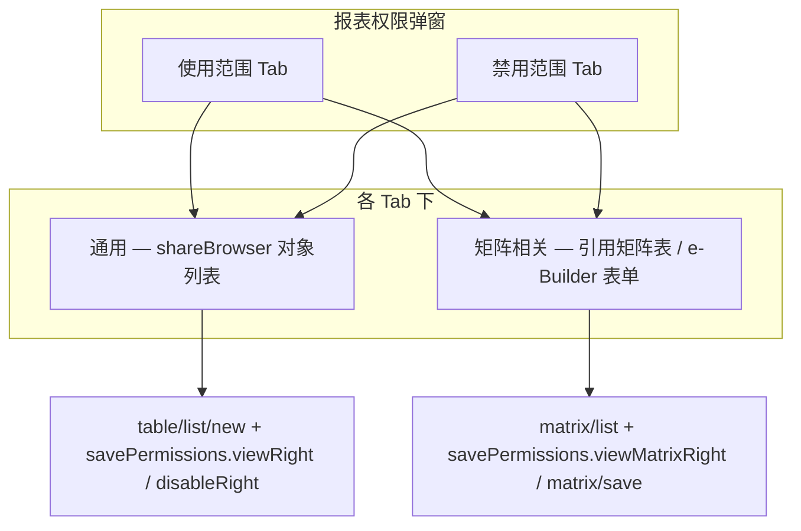

# 报表使用权限 · 完整 API 指南

> **UI 入口**：应用报表列表 → 报表卡片「…」→ **报表权限**  
> **弹窗结构**：顶层 **使用范围** / **禁用范围**；各含子 Tab **通用** / **矩阵相关**  
> **源码依据**：`EdcDataPermissionController.java`、`EdcReportMatrixRight.java`、`DataRightType.java`、`EdcReportDevAnalysisController.java`（weaver-edcreportd / weaver-common-edc）  
> **组件契约**：与平台 **shareBrowser** 一致（同动作流 SendMessage「提醒对象」枚举，见 e10-cli `formula_service.py`）  
> **设计区保护**：权限仅走 `savePermissions` / `matrix/save`，**禁止**为改权限调用 `saveReportDevInfo`（见 `safe-partial-save-guide.md`）

---

## 一、UI 结构与 API 映射



| UI 区域 | 读接口 | 写接口 | 说明 |
|---------|--------|--------|------|
| 使用范围 · 通用 | `table/list/new` + `permissionType: 1` | `savePermissions` → `viewRight` | 人员/部门/…/所有人 |
| 使用范围 · 矩阵 | `matrix/list` + `type: "1"` | `savePermissions` → `viewMatrixRight` | 保存前服务端会把 `id` 改为 `tmp_*` |
| 禁用范围 · 通用 | `table/list/new` + `permissionType: -1` | `savePermissions` → `disableRight` | 命中则**否决**查看权 |
| 禁用范围 · 矩阵 | `matrix/list` + `type: "-1"` | `matrix/save`（`rightsType: "-1"`） | **注意**：`savePermissions` 只处理 `viewMatrixRight`，禁用矩阵需单独 `matrix/save` |

**运行时判定**（`EdcReportDevAnalysisController`）：

```
可查看 = (后台查看 ∨ 前台查看 ∨ 使用矩阵 ∨ 使用权限组)
      ∧ ¬(禁用通用 ∨ 禁用矩阵 ∨ 禁用权限组)
```

---

## 二、DataRightType 与 permissionType

| permissionType | 含义 | UI Tab | permissionId |
|----------------|------|--------|--------------|
| `1` | 后台查看（使用范围） | 使用范围 · 通用/矩阵 | `report_view` |
| `-1` | 后台禁用（禁用范围） | 禁用范围 · 通用 | `report_view` |
| `2` | 前台查看 | （部分环境/前台入口） | `report_view` |
| `-2` | 前台禁用 | | `report_view` |
| `11`–`17` | 按钮级（导出 Excel/PDF/打印/快照等） | 非本弹窗主体 | `report_view` |

矩阵 `rightsType` 与上表 **code 字符串**一致：`"1"`=使用，`"-1"`=禁用。

---

## 三、通用 Tab · 九种对象类型（shareBrowser）

设计器下拉与 API 字段 **`objType`** 对照（**人员**在 API 中为 `resource`，不是 `user`）：

| UI 名称 | objType | obj_id 字段 | _entityType | targetType | targetId | 备注 |
|---------|---------|-------------|-------------|------------|----------|------|
| 人员 | `resource` | `obj_id` | `resource` | `1` | 人员 ID | 可加 `user_type`（1 当前人员…） |
| 部门 | `department` | `obj_id_department` | `dept` | `2` | 部门 ID | Live 实测 `.workbuddy/set_report_view_scope.py` |
| 分部 | `subcompany` | `obj_id_subcompany` | `subcompany` | `4` | 分部 ID | 可加 `department_attribute` |
| 角色 | `role` | `obj_id_role` | `role` | **`10`** | 角色 ID | 可加 `role_level`（0 总部/1 分部/2 部门） |
| 群组 | `channel` | `obj_id_channel` | `channel` | **`14`** | 群组 ID | UI 称「群组」，浏览器为 `hrm/.../channel`；非 `group`/`targetType:5` |
| 群组 | ~~`group`~~ | ~~`obj_id_group`~~ | — | ~~5~~ | — | **勿用**：`5` 会被存成分部 |
| 岗位 | `position` | `obj_id_position` | `position` | `6` | 岗位 ID | 可加 `position_level` 等 |
| 所有人 | `all` | （无） | `all` | `11` | `0` | Live 实测 copy 脚本 |
| 外部联系人 | `external` | `obj_id_external` | `external` | `7` | 外部人 ID | 须 browser 查真实 ID |
| 所有外部人 | `allExternal` | （无） | `allExternal` | `12` | `0` | 无对象选择框 |

> **targetType 金标准**（`edc_report_ph_report_view` 的 `org_config.typeEnum`，weaver-edcreportd SQL）：  
> 人员 `1|17` · 部门 `2|3|4|…` · 分部 `5|6|7|…` · **角色 `10`** · **群组(channel) `14|1411`** · 岗位 `12|13|…` · 外部 `110` · 所有人 `11`  
> 写入前务必 `table/list/new` 回读；**禁止**把角色写成 `targetType:3`、群组写成 `targetType:5`（会分别落库为部门/分部）。  
> **安全级别**：通用项均可带 `seclevel: {"min": -999, "max": 999}`（UI「安全级别」列）。

### 3.1 读列表

```http
POST /api/bs/edc/report/permission/table/list/new
Content-Type: application/json

{
  "permissionId": "report_view",
  "id": "<reportId>",
  "current": 1,
  "pageSize": 50,
  "permissionType": 1,
  "params": { "appId": "<appId>" }
}
```

- **使用范围**：`permissionType: 1`
- **禁用范围**：`permissionType: -1`
- 返回列含 `objType`、`obj_id`/`obj_id_span`、**安全级别** `level`

### 3.2 写 — savePermissions（全量替换）

`savePermissions` 对每张报表 **先删后增**（view + disable 通用项；使用矩阵 rightsType=1 软删后重建）：

```json
{
  "<reportId>": {
    "viewRight": [ /* permissionType: 1 的 shareBrowser 行 */ ],
    "disableRight": [ /* permissionType: -1 的 shareBrowser 行 */ ],
    "viewMatrixRight": [ /* 使用范围 · 矩阵行，见 §四 */ ]
  }
}
```

**shareBrowser 行公共字段**：

| 字段 | 说明 |
|------|------|
| `sourceId` | 报表 ID（字符串） |
| `permissionId` | 固定 `"report_view"` |
| `permissionType` | 使用 `1`，禁用 `-1` |
| `sourceType` | `1` |
| `targetType` / `targetId` | 见上表 |
| `objType` / `objTypeSpan` | 类型枚举与 UI 文案 |
| `_entityType` | 前端实体类型 |
| `obj_id_*` | 对象展示数组（含 id/name/content） |
| `obj_id_span` / `objIdList` / `content` / `name` | 列表展示 |
| `seclevel` | 安全级别范围 |
| `shareKey` | 新建可用 `tmp_<type>_<id>_<随机>` |

### 3.3 示例

**所有人（使用范围）** — 见 `scripts/report_lifecycle.js` → `everyoneViewRight()`：

```json
{
  "sourceId": "<reportId>",
  "permissionId": "report_view",
  "permissionType": 1,
  "targetType": 11,
  "targetId": 0,
  "sourceType": 1,
  "objType": "all",
  "objTypeSpan": "所有人",
  "_entityType": "all",
  "obj_id_all": [{ "content": "所有人", "icon": "Icon-all02", "id": "0" }],
  "obj_id_span": "所有人",
  "objIdList": ["所有人"],
  "seclevel": { "min": -999, "max": 999 },
  "shareKey": "tmp_all_0_abc123"
}
```

**部门（使用范围）** — 见 `.workbuddy/set_report_view_scope.py`：

```json
{
  "sourceId": "<reportId>",
  "permissionId": "report_view",
  "permissionType": 1,
  "targetType": 2,
  "targetId": "<deptId>",
  "sourceType": 1,
  "objType": "department",
  "objTypeSpan": "部门",
  "_entityType": "dept",
  "obj_id_department": [{ "id": "<deptId>", "name": "总经办", "content": "总经办", "title": "总经办" }],
  "obj_id_span": "总经办",
  "objIdList": ["总经办"],
  "seclevel": { "min": -999, "max": 999 },
  "shareKey": "tmp_dept_<deptId>_abc123"
}
```

**禁用某部门** — 与上相同结构，仅改 `permissionType: -1`，放入 `disableRight` 数组。

**人员（使用范围）** — `objType: "resource"`，`targetType: 1`，`obj_id` 为人员对象数组。

### 3.4 对象 ID 查询（browser）

| UI 对象 | 推荐 browser | 说明 |
|---------|--------------|------|
| 人员 | `POST /api/edc/report/common/browser/complete/resource` | 报表权限弹窗内 browser |
| 部门 | `POST /api/workflow/pathdef/common/browser/complete/department` | body 含 `searchValue` |
| 角色 | `POST /api/hrm/common/browser/complete/role` | body 含 `searchValue` |
| **群组** | **`POST /api/hrm/common/browser/data/channel`** | **勿用** `/.../group`（返回 browser not found）；UI 称群组，API 类型为 `channel` |
| 分部/岗位 | 设计器 shareBrowser 抓包为准 | 报表弹窗 browser 常仅注册 resource/role/department/subcompany |

**Live 示例**（eteams · 进销存应用）：

| 对象 | 搜索名 | ID |
|------|--------|-----|
| 角色 eb分权管理员 | `complete/role` | `845885352284553217` |
| 群组 测试-zc0813 | `data/channel` + keywords `zc0813` | `1303036100793573378` |

---

## 四、矩阵相关 Tab

UI：**引用矩阵表**（矩阵表 / e-Builder 表单）→ **条件** → **取值字段** → 添加 → 使用列表。

实体 `EdcReportMatrixRight`（表 `edc_report_matrix_right`）：

| 字段 | 说明 |
|------|------|
| `selectedType` | 组织/矩阵类型，传入 `OrgType.valueOf(...)`（如矩阵表、e-Builder 表单，**抓包为准**） |
| `dataId` | JSON 字符串，矩阵/表单引用，如 `[{"id":"<matrixOrFormId>","name":"..."}]` |
| `matrixConditionData` | 矩阵值**条件**（平台矩阵条件 DSL，JSON 字符串） |
| `matrixValueRelation` | 矩阵值**关系/取值字段**映射（JSON 字符串） |
| `targetId` | 报表 ID |
| `rightsType` | `"1"` 使用范围矩阵；`"-1"` 禁用范围矩阵 |
| `rightsName` | 展示名称（可选） |

校验走 `EBMatrixPermissionDubboService.checkMatrixPermission`。

### 4.1 读矩阵列表

```http
POST /api/bs/edc/report/permission/matrix/list

{ "target": "<reportId>", "type": "1" }
```

- 使用范围：`type: "1"`
- 禁用范围：`type: "-1"`

### 4.2 写 — 使用范围矩阵（推荐并入 savePermissions）

```json
{
  "<reportId>": {
    "viewRight": [],
    "disableRight": [],
    "viewMatrixRight": [
      {
        "id": "tmp_matrix_001",
        "targetId": "<reportId>",
        "selectedType": "<OrgType枚举名>",
        "dataId": "[{\"id\":\"<matrixId>\",\"name\":\"矩阵表名\"}]",
        "matrixConditionData": "<条件JSON字符串>",
        "matrixValueRelation": "<取值字段JSON字符串>",
        "rightsType": "1",
        "rightsName": "矩阵权限说明"
      }
    ]
  }
}
```

服务端保存前会将 `id` 前缀改为 `tmp_` 再插入。

### 4.3 写 — 禁用范围矩阵（单独 matrix/save）

`savePermissions` **不**处理禁用矩阵；需：

```http
POST /api/bs/edc/report/permission/matrix/save
Content-Type: application/json

[
  {
    "id": "tmp_disable_matrix_001",
    "targetId": "<reportId>",
    "selectedType": "<OrgType>",
    "dataId": "[{...}]",
    "matrixConditionData": "...",
    "matrixValueRelation": "...",
    "rightsType": "-1"
  }
]
```

> **矩阵字段 JSON 结构**因「矩阵表 vs e-Builder 表单」及租户配置而异，**必须以设计器 Network 抓包为金标准**；Skill 禁止臆造 `matrixConditionData` / `matrixValueRelation` 内部键名。

---

## 五、权限组（shareGroup，补充）

`table/list/new` 在传入 `params.appId` 时，会 **append** 应用级权限组行（`objType: "shareGroup"`）。  
源码 `EdcReportGroupRightServiceImpl.getGroupRights` 注明：**禁用范围权限组回显暂未支持**（permissionType ≠ 1 时返回空）。

---

## 六、脚本与客户端

| 能力 | Node | Python |
|------|------|--------|
| 复制 + 所有人 + 加菜单 | `report_lifecycle.js` | `copy_sheet` / `save_permissions` / `add_report_to_menu` |
| **任意使用范围** | **`set_report_view_scope.js`** | `build_share_entry` + `save_permissions` |
| 存为新版本 | `save_as_version.js`（`--list-only` 只读） | `save_as_version()` |
| 构建 share 行 | — | `ReportApiClient.build_share_entry()`（`group`→`channel`） |
| 列表/矩阵读 | — | `list_permission_table` / `list_matrix_rights` |
| **矩阵增删 CLI** | **`report_list_ops.js` / `edc-report scope matrix`** | `delete_use_matrix_by_replace` / `soft_delete_matrix_row` / `save_matrix_rights` |

**Node — 矩阵列表 / 添加 / 删除**：

```bash
edc-report scope matrix list --app-id <appId> --report-id <id> --type 1
edc-report scope matrix save --app-id <appId> --report-id <id> --file matrix-row.json --type 1
edc-report scope matrix delete --app-id <appId> --report-id <id> --matrix-id <mid> --type 1
```

> 使用矩阵删除走 `savePermissions` 全量替换剩余行；禁用矩阵删除走 `matrix/save` + `deleteType:1`。条件 DSL 须抓包，见 §4.2/4.3。  
> 列表页分组/移动/转移见 **`report-list-page-ops-guide.md`**。

**Node — 角色 + 群组使用范围**：

```bash
node scripts/set_report_view_scope.js \
  --host https://<your-e10-host> \
  --app-id <your-app-id> \
  --report-id 1310967397636390912 \
  --scope "role:eb分权管理员,channel:测试-zc0813"
```

**Python 示例**：

```python
from report_api_client import ReportApiClient

client = ReportApiClient(...)
rid = "1310967397636390912"
client.save_permissions(rid, {
    "viewRight": [client.build_share_entry("all", report_id=rid)],
    "disableRight": [client.build_share_entry("department", "123", "总经办", report_id=rid, permission_type=-1)],
    "viewMatrixRight": [],
})
client.list_permission_table(rid, "report_view", permission_type=-1)  # 回读禁用范围
```

---

## 七、验证清单

1. **使用范围通用**：`table/list/new` + `permissionType:1` 行数与 objType 正确  
2. **禁用范围通用**：`permissionType:-1` 能回读  
3. **使用矩阵**：`matrix/list` + `type:"1"`  
4. **禁用矩阵**：`matrix/list` + `type:"-1"`（若 UI 已配置）  
5. **运行时**：目标用户在「使用」内且不在「禁用」内时可打开分析页 `/api/bs/edc/report/analysis/...`  
6. **雪花 ID**：reportId / targetId 全程字符串化，见 `snowflake-id-precision-guide.md`

---

## 八、常见错误

| 现象 | 原因 | 处理 |
|------|------|------|
| 只写了 `objType: "user"` | 设计器不认 | 改为 `objType: "resource"` |
| 禁用矩阵保存后丢失 | 只调了 savePermissions | 禁用矩阵用 `matrix/save` + `rightsType:"-1"` |
| 角色写成 `targetType:3` | 落库成**部门** | 角色 = **`10`** |
| 群组写成 `targetType:5` 或 `objType:group` | 落库成**分部** | 群组 = **`channel` + targetType `14`** |
| 搜群组用 `/browser/.../group` | browser not found | 改用 **`/hrm/.../data/channel`** |
| 部门 targetType 写成 3 | 与角色混淆 | 部门 = **`2`** |
| 权限 ID 末位漂移 | JS JSON.parse | 用 `json_snowflake.js` / `json_snowflake.py` |
| savePermissions 后旧行还在 | 误解为增量 | 接口为**全量替换**，需提交完整 viewRight/disableRight |

---

## 关联文档

- `report-lifecycle-api-guide.md` — 复制/菜单/删除与权限入口总览  
- `snowflake-id-precision-guide.md` — ID 精度  
- `api-auth-headers.md` — 鉴权三项
